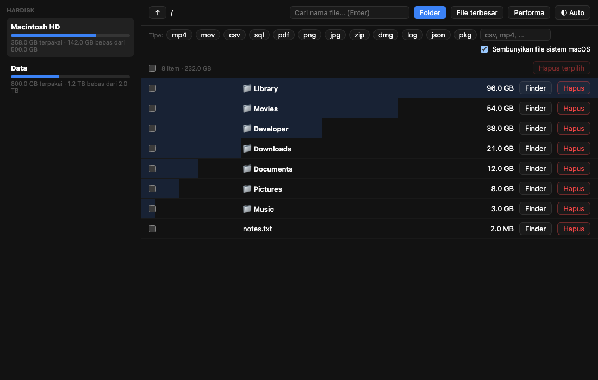
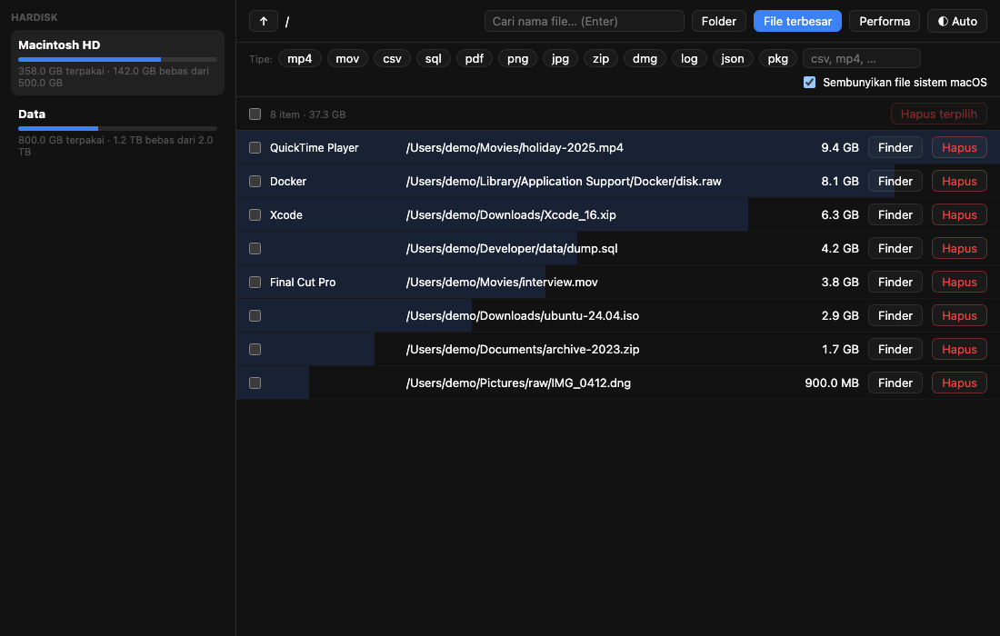
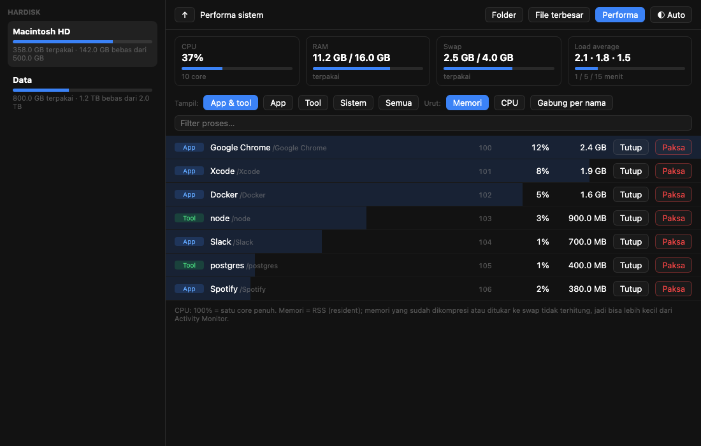

# Disk Analyzer

Aplikasi macOS kecil untuk melihat apa yang memakan ruang hardisk, dan proses mana yang memakan RAM/CPU. Dibuat dengan [Tauri 2](https://tauri.app) (Rust + satu file HTML).

## Fitur

- **Folder**: pindai hardisk, lihat ukuran tiap folder dan masuk lebih dalam.
- **File terbesar**: daftar file terbesar di bawah folder terpilih.
- **Cari**: cari berdasarkan nama atau tipe file (mp4, csv, zip, dst).
- **Pemilik file**: tiap file menampilkan nama dan logo aplikasi pemiliknya.
- **Hapus**: hapus satu atau banyak file sekaligus, dengan dialog konfirmasi. File sistem macOS disembunyikan dan tidak pernah bisa dihapus dari app ini.
- **Performa**: CPU, RAM, swap, load average, dan daftar proses. Bisa difilter (App / Tool / Sistem), diurutkan, digabung per nama, lalu ditutup atau dipaksa berhenti.
- Tema terang, gelap, atau otomatis.

## Screenshot

Screenshot memakai data contoh.

| Folder | File terbesar |
|---|---|
|  |  |



## Menjalankan

Butuh [Rust](https://rustup.rs) dan Node.js.

```bash
npm install
npm run dev     # mode pengembangan
npm run build   # hasil build di target/release/bundle/macos
```

Script di `package.json` memakai `CARGO_TARGET_DIR=/Volumes/cargo-build/target`. Ubah ke folder lain jika volume itu tidak ada.

## Struktur

- `dist/index.html`: seluruh UI (HTML, CSS, JS tanpa framework).
- `src-tauri/src/main.rs`: perintah backend (`volumes`, `analyze`, `search`, `delete_path`, `perf`, `kill_process`, `app_info`, dst).

## Catatan

Hanya diuji di macOS. Menghapus file bersifat permanen, jadi periksa dialog konfirmasi sebelum melanjutkan.
